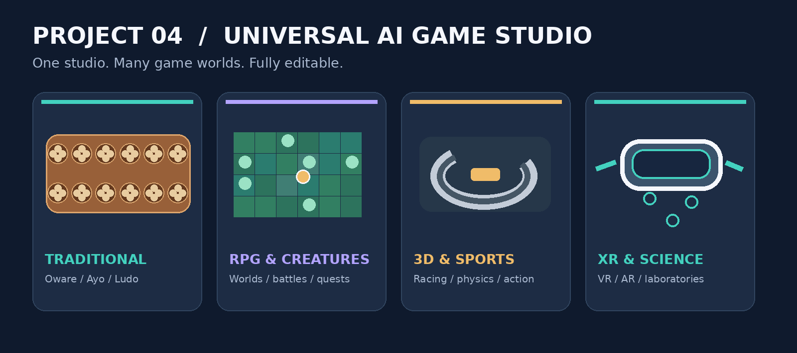
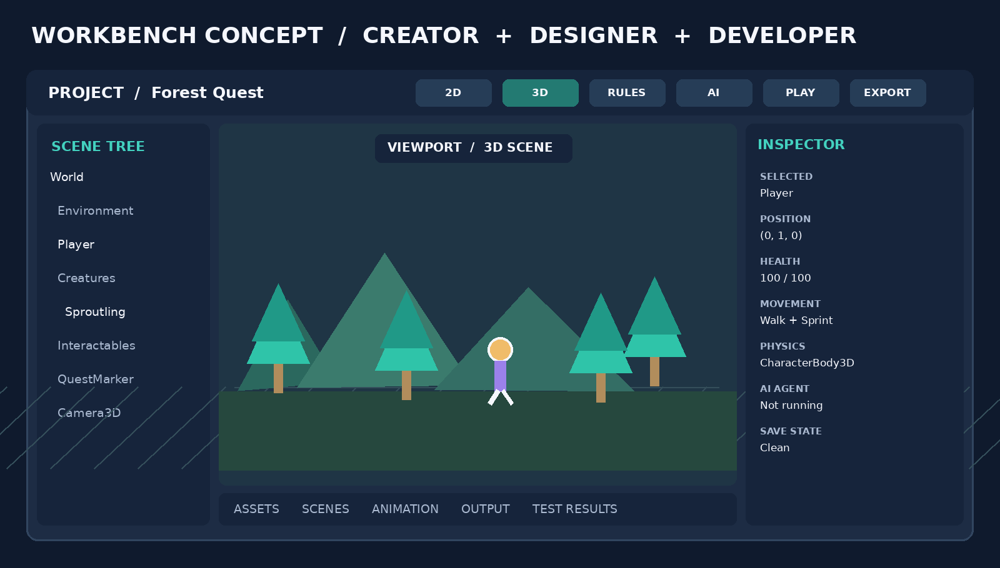
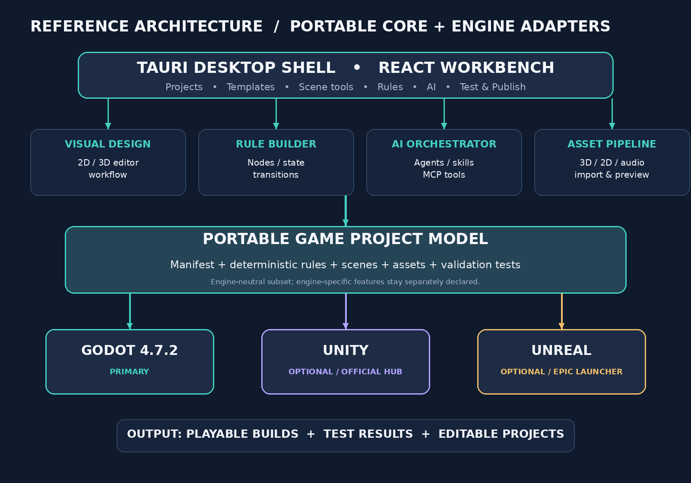
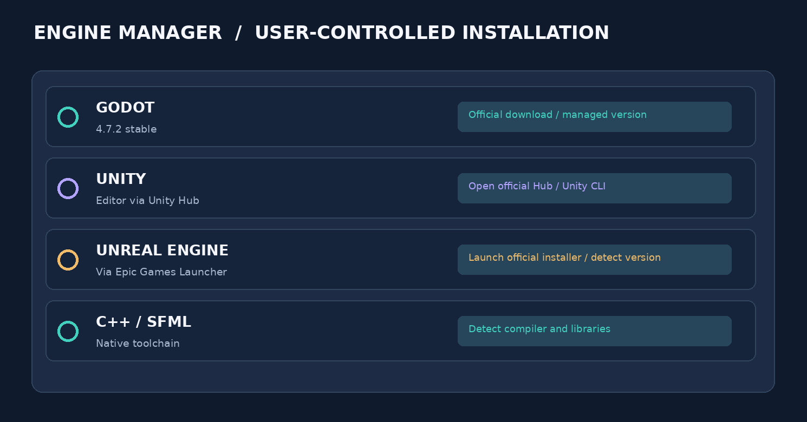
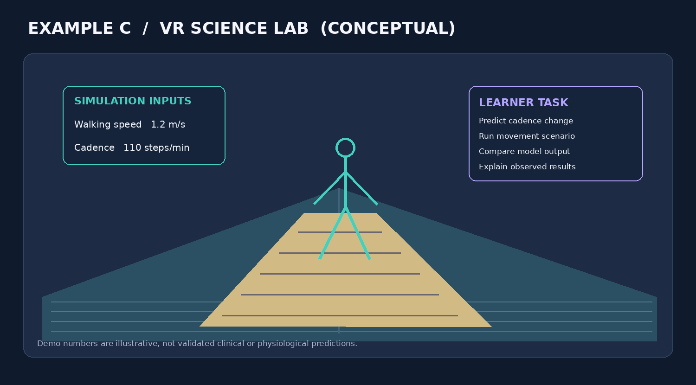
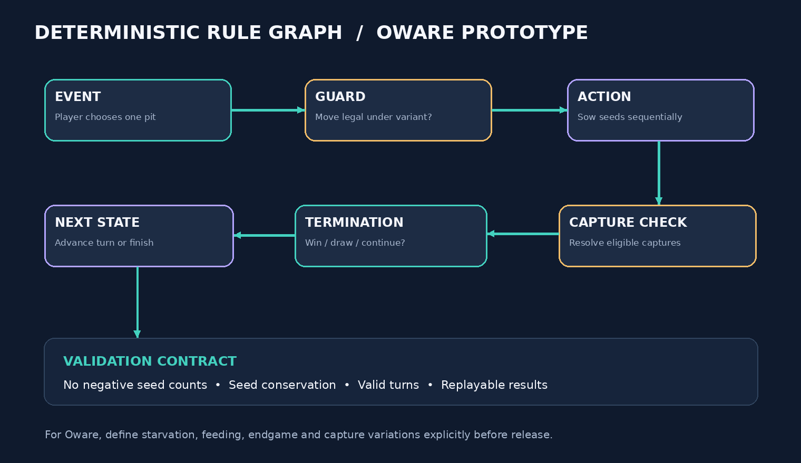
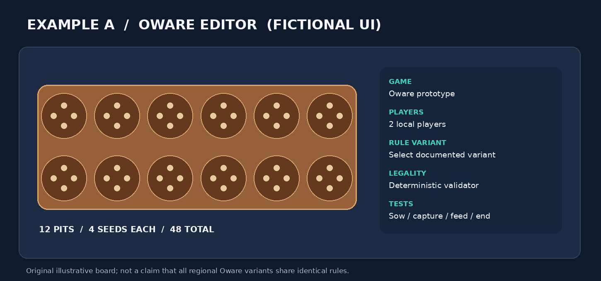
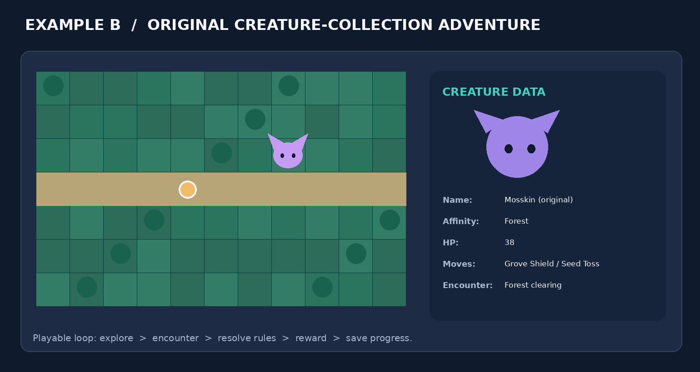

# Universal AI Game Studio

Master architecture, visual concepts, game examples, implementation roadmap, and Codex / Claude instructions

Version 1.0  |  Prepared November 15, 2026  |  Working title: Project 4



> North star: create reliable, playable, editable games through visual design, reusable rules, and AI assistance—without creating a new rendering engine.

This is a build specification, not a claim that the proposed product or its integrations already exist. Screens and game imagery in this package are original illustrative mockups, not live screenshots.


---


## Quick navigation

1. Product charter and acceptance criteria
2. User experience and illustrated workbench
3. System architecture and platform choices
4. Engine manager, Unity/Unreal support and XR
5. Rules, traditional games and Oware example
6. Creature-collection RPG, science and other genres
7. AI agents, skill registry and safe tool execution
8. Open-source components and licensing assessment
9. Repository structure, project format and APIs
10. Phased implementation roadmap and testing gates
11. First sprint and collaboration process
12. Ready-to-paste Codex instruction
13. Ready-to-paste Claude instruction
14. References and verification notes


## 1. Product charter

Build an AI-assisted, modular desktop game creation studio for educators, researchers, independent developers and experienced teams. A user can design visually, describe changes in natural language or write code. Each approach must produce real engine assets and executable gameplay.

| Dimension | Decision |
|---|---|
| Core value | Beginner-friendly creation + professional controls + reliable AI assistance |
| Primary engine | Godot 4.7.2 stable, with version pinning per project |
| Desktop shell | Tauri 2 / React / TypeScript |
| First demonstration games | Oware (complete rules after variant confirmation) and a small original 3D adventure |
| Initial UI integration | Separate but coordinated Tauri workbench and Godot editor; no custom 3D renderer |
| Broader engines | Unity and Unreal adapters later; detect installed versions and use official managers |
| Immersive mode | OpenXR and Godot XR Tools, gated on actual hardware and platform support |
| Supported workflows | Creator, Designer and Developer modes over one project model |


### Non-negotiable engineering principles

- Every visible control must correspond to a verified operation or clearly be marked unavailable.
- Keep gameplay rules deterministic; AI proposes mechanics but does not adjudicate every move.
- Preserve game data, save formats and editor state across updates.
- Store shared, portable game information separately from engine-specific scenes and components.
- Never silently install a large engine, accept a license, or launch arbitrary downloaded binaries.
- Benchmark actual build, launch, export and gameplay behavior instead of relying on screenshots alone.


### Explicit exclusions from the first release

Do not start by recreating Unity/Unreal, building an AAA open world, hosting multiplayer infrastructure, training a proprietary generative model, or writing a custom full-featured 3D editor. These are later options, not MVP dependencies.


## 2. Product experience and visual workbench




### Three work modes

| Mode | Main interaction | Initial tools |
|---|---|---|
| Creator | Templates, drag-and-drop, simple properties | Project gallery, asset library, behavior presets, Play |
| Designer | Editable visual rules and state machines | React Flow rule editor, scenes, conditions, animations |
| Developer | Code and detailed engine tools | Godot editor, script inspection, test logs, profiling |


### Critical user journeys

1. New project: choose game category > pick engine > create a versioned template > open playable sample.
2. Edit a game: select object > change properties or rule graph > preview diff > run tests > save.
3. Use AI: enter requested change > inspect concise plan > approve tool actions > review playable result.
4. Manage engines: detect installed Godot/Unity/Unreal, report versions and compatibility, launch official setup when missing.
5. Export: validate target requirements, build locally and show reproducible artifact path and logs.


## 3. Architecture and integration boundaries




### Separation of concerns

- Tauri workbench: projects, templates, assets, rule graphs, agents, settings, build dashboard.
- Core model: project manifest, rule specifications, scene metadata, assets, tests and audit history.
- Godot bridge: project creation, scene editing commands, asset import, run, test and export.
- Engine adapters: version detection, capabilities, project generation, launch, validation and build operations.
- AI orchestrator: scoped task planning, agent invocation, validated edits, review and rollback.
- Scientific and educational plugins: defined models, lesson objectives, quiz logic, validation metadata.


### Cross-engine portability contract

Only a defined subset is portable: game metadata, asset references, simple scene hierarchy, dialogue, mathematical rules, input mapping and selected component definitions. Custom shaders, physics plugins, Blueprint graphs, high-end rendering systems and engine-specific scripts must be labeled nonportable. If conversion is incomplete, the studio must explain exactly what is not preserved.


### Native scene workflow decision

In the MVP, use Godot as the source of truth for scenes and graphics. The Tauri workbench offers project management and structured editing, then opens or communicates with the Godot editor through a local adapter. Embedding an arbitrary Unity/Unreal viewport inside Tauri is not an MVP requirement.


## 4. Engine Manager and XR Studio




### Installation and version rules

| Engine | MVP behavior | Later integration |
|---|---|---|
| Godot | Detect current version; download official stable builds only with user approval; pin project version | Project-aware updates, templates and export presets |
| Unity | Detect Unity Hub/editor; open official Unity Hub or Unity CLI workflow | Project adapter; editor scripting and validated packages |
| Unreal | Detect Epic Games Launcher and installed engines; open official installation flow | Editor automation, UProject templates, Blueprint-oriented actions |
| C++/SFML | Detect compiler and SDK; validate toolchain | Starter templates, debugging and engine-neutral teaching workflows |

As verified November 15, 2026, Godot 4.7.2 is stable and 4.8 beta is not the default production baseline. Unity Hub 4.0.0 release notes (November 13, 2026) describe a newer Unity CLI replacing Hub headless command mode, so any automation must feature-detect the installed Hub/CLI instead of assuming obsolete flags. Epic documents Launcher-mediated Unreal installation.


### XR scope



- First XR milestone: a Godot/OpenXR scene with locomotion, grabbing, controller input, UI and spatial audio.
- Adopt a maintained compatible Godot XR Tools release; do not assume every headset feature is supported.
- Record target platform, runtime, input profile, headset capabilities and comfort options.
- A desktop simulator can verify some interactions; actual headset deployment requires device-specific testing.
- Physics-based educational experiences must label simulated versus validated scientific outcomes.
- Unity XR Toolkit and Unreal OpenXR projects become separate adapters once a real vertical slice passes.


## 5. Deterministic rules and African traditional games




### Game rule model

Represent a game using players, initial state, actions, legal move predicates, deterministic transitions, turn order, terminal conditions, scoring, randomness policies, replay log and named variants. The visual rule editor compiles to a validated intermediate representation with engine-independent tests.




### Oware vertical-slice acceptance tests

- Two human players can start, choose legal pits, sow seeds, continue turns and finish according to a documented named variant.
- The implementation handles captures, feeding/starvation constraints and endgame conditions consistent with that variant.
- A replay log reproduces the same result; undo is accurate; invalid actions do not modify state.
- Seed counts remain nonnegative and seeds are conserved across pits and capture stores.
- At least 30 deterministic unit tests cover boundaries and game-ending sequences; add property-based cases where practical.
- Never present one undocumented rule set as universal across Ghanaian, Nigerian or other regional traditions.


### Later cultural game library

Model Oware, Ayo, Ludo and additional regional games as separate documented templates with ruleset provenance, localized names, pronunciation support where verified, cultural notes and accessibility options. Ludii is highly relevant as a research reference for game-description abstractions; do not integrate its non-commercial source without permission or legal review.


## 6. Other example game templates


### Creature-collection RPG, with original intellectual property



Sample game concept: Forest Quest. A learner explores a small West African-inspired fantasy map, meets original creatures, solves simple environment puzzles, collects a limited number of companions and plays deterministic turn-based encounters. All creatures, artwork, names, audio, mechanics and worldbuilding must be original or appropriately licensed.

| Template subsystem | Initial sample feature | First acceptance condition |
|---|---|---|
| Overworld | Small 2D or 3D map with triggers | Player moves and collisions work |
| Creature catalog | Three original creatures with structured stats | Creatures validate against schema |
| Encounter system | Turn-based encounter and reward | Deterministic outcomes and replay |
| Quest system | Collect one artifact and return | Quest state persists after restart |
| Content tools | AI creates proposed creature data | User can inspect, edit and reject changes |


### Science / learning simulation

Sample: a VR or desktop gait-lab exercise with adjustable walking speed, avatar animation, data plots and explanation prompts. Simulated values need clear provenance; if results are educational illustrations, label them as such. Separate a validated physiological model from a visual animation preset.


### Other genre packs, later

Platformer pack (2D collision and checkpoints); driving pack (vehicle physics and track editor); sports pack (physics and scoring); branching philosophy dialogue pack (argument graph and player choices); quiz/adaptive learning pack (assessment validity and feedback); narrative RPG pack (inventory, quests and states); multiplayer turn-based pack. Build these from composable components, not independent mini-engines.


## 7. AI agents, skills and token discipline


### Agent roster

| Agent | Responsibilities | Explicit boundary |
|---|---|---|
| Producer / Planner | Turn request into minimum scoped change plan | No autonomous expansion of product scope |
| Gameplay Engineer | Implement events, components, rules and scripts | Must follow core game model |
| Visual Scene Agent | Modify scenes, assets and layouts | No undeclared destructive writes |
| Rule & Cultural Reviewer | Audit rules, variants, terminology and references | Cannot invent historical provenance |
| Educational Design Agent | Connect learning outcomes to game feedback | Cannot claim scientific validation without evidence |
| Test & Performance Agent | Run playability, builds, regressions, benchmarks | Must attach reproducible evidence |


### Skill registry contract

```yaml
skill_id: create_turn_based_game
version: 1.0.0
inputs: [project_id, ruleset_id, theme_id]
tools_allowed: [read_project, patch_rulegraph, run_rule_tests]
permissions: [project_scoped_write]
validation: [schema_valid, deterministic_tests_pass]
rollback: git_snapshot
max_retries_per_operation: 2
```


### Execution safety and efficiency

1. Read the minimum necessary context: repository tree, manifest, impacted modules and relevant tests.
2. Estimate task surface area and choose one primary agent; add specialists only when evidence demands them.
3. Prefer structured editor API calls over free-form shell operations.
4. Stage edits as a diff and checkpoint the project before risky actions.
5. Run the narrowest meaningful test set first, followed by broader regression tests at gate completion.
6. If an operation fails twice, stop repeating it, switch approach or report the blocker.
7. Maintain bounded token and tool-use budgets; cache summaries and reuse verified tool results.

User-selectable local and cloud LLM providers are optional. AI must not be necessary to play, save, reopen or export an already created game. Do not embed credentials in projects or logs.


## 8. Open-source adaptation shortlist

Candidates should be reviewed for maintenance, compatibility, dependency security, attribution and licensing before adopting code. “Reference” means study concepts; “Integrate” means build a small tested adapter only after approval.

| Project / URL | Role | MVP disposition |
|---|---|---|
| godotengine/godot  —  github.com/godotengine/godot | MIT; main game engine | Use |
| 4ian/GDevelop  —  github.com/4ian/GDevelop | MIT core; event UX reference | Reference |
| CraterCrash/godot-orchestrator  —  github.com/CraterCrash/godot-orchestrator | Apache-2.0; visual Godot scripts; 2.5.x for Godot 4.7.x | Compatibility spike |
| xyflow/xyflow  —  github.com/xyflow/xyflow | MIT; React Flow node graph editor | Use |
| GodotVR/godot-xr-tools  —  github.com/GodotVR/godot-xr-tools | MIT code; VR interaction library | Phase XR |
| boardgameio/boardgame.io  —  github.com/boardgameio/boardgame.io | MIT; turn-based web games | Later adapter |
| google-deepmind/open_spiel  —  github.com/google-deepmind/open_spiel | Apache-2.0; game theory and algorithms | Research / testing |
| Ludeme/Ludii  —  github.com/Ludeme/Ludii | Non-commercial/no-derivatives portal license; game formalism | Research only; permission review |
| Blender  —  blender.org | 3D modeling and glTF export | External tooling |

Orchestrator documents v2.5.x for Godot 4.7.x. Check both exact version and extension ABI at integration time. Not all community MCP/editor automation repositories are sufficiently mature for an unattended production dependency.


## 9. Repository layout, data formats and interfaces


### Suggested monorepo layout

```text
game-studio/
  apps/{desktop,bridge-service}/
  packages/
    project-schema/          # versioned manifest
    rules-core/              # deterministic state + replay
    rule-editor/             # React Flow editor
    agent-contracts/         # skills and permissions
    engine-api/              # typed engine contract
    ui-kit/                  # shared design tokens
  adapters/{godot,unity,unreal}/
  templates/{oware,exploration-3d,creature-rpg,xr-science}/
  tests/{contracts,integration,end-to-end}/
  docs/{architecture,decisions,audits}/
  scripts/
```


### Sample project manifest

```json
{
  "schemaVersion": "1.0.0",
  "projectId": "forest-quest-demo",
  "title": "Forest Quest",
  "genre": ["adventure", "creature-collection"],
  "engine": {"id": "godot", "version": "4.7.2"},
  "portableFeatures": ["rules", "dialogue", "asset-index"],
  "engineSpecific": {"sceneRoot": "res://scenes/main.tscn"},
  "ruleset": "rules/encounters.v1.json",
  "testProfile": "tests/smoke.yaml"
}
```


### Engine adapter interface (design sketch)

```typescript
interface EngineAdapter {
  id: string;
  discover(): Promise<EngineInstallation[]>;
  capabilities(): Promise<EngineCapabilities>;
  createProject(spec: GameProjectSpec): Promise<ProjectRef>;
  openProject(project: ProjectRef): Promise<void>;
  validate(project: ProjectRef): Promise<ValidationReport>;
  run(project: ProjectRef): Promise<RunResult>;
  export(project: ProjectRef, target: ExportTarget): Promise<BuildResult>;
}
```

All adapter methods return typed results and structured errors. Unity/Unreal methods initially return capability-not-implemented rather than pretending to succeed.


### Event and rule contracts

The rule runtime should expose applyAction(state, action, ruleset) -> newState, emittedEvents, and validationReport. Rules are versioned; each change is traceable and replayable. Inputs are schema-validated, untrusted project paths are normalized, and command execution is allowlisted.


## 10. Build roadmap and evidence gates

| Gate | Minimum deliverable | Proof before advancing |
|---|---|---|
| 0 — Repository & ADRs | Monorepo; CI; architecture decision records; design tokens | Fresh setup, typecheck, unit-test and dev launch |
| 1 — Desktop shell | Tauri React UI; project library, create/open/save, status | Project survives app restart and file reopen |
| 2 — Godot bridge | Engine detection, project template, run, stdout/stderr capture | Generated 3D template launches from workbench |
| 3 — Oware vertical slice | Rule runtime, UI, save/replay, tests | Rules validated and sample game finishes cleanly |
| 4 — Visual rule editing | Graph editor, compile, edit/undo, inspector | Changing node causes proven gameplay behavior change |
| 5 — Agent execution | Scoped AI edits, review diff, rollback, test run | AI modifies an existing project without data loss |
| 6 — Genre expansion | Creature RPG prototype; simple 3D interaction | Quest progress and encounters persist |
| 7 — XR verification | OpenXR sample, locomotion and interaction | Desktop smoke tests plus headset test if device exists |
| 8 — Additional engines | Unity adapter then Unreal adapter | Verified installs, capabilities and real project launch |

Do not launch all gates simultaneously. Gates 0–3 establish the critical vertical slice. A gate only passes after code, demo steps, test logs and known limitations are recorded.


### Quality gates

- Unit tests: core transitions, engine-adapter parsers, schema migrations and permission checks.
- Integration tests: create/open/save/close/reopen, Godot import and run, asset reload.
- End-to-end: keyboard-only workflow, error recovery, one complete game session, build output.
- Visual QA: screenshot comparisons for navigation and inspectors; no overlapping text or dead controls.
- Performance: app launch, frame rate, memory and export duration recorded with environment details, no arbitrary guarantees.
- Regression: project format migration preserves samples and has backups.
- Security: path traversal, malicious archives, model-generated shell commands and dependency review.


## 11. First sprint: exact execution order

1. Inspect the existing repository. If empty, initialize a clean monorepo; if not empty, preserve project structure and avoid broad rewrites.
2. Create docs/architecture/overview.md, docs/decisions/ADR-0001-engine-strategy.md, docs/decisions/ADR-0002-project-format.md.
3. Scaffold Tauri 2 + React + TypeScript with one consistent visual system and required basic tests.
4. Implement typed project manifest, project CRUD and local recent-project list.
5. Implement Godot discovery and a small adapter that opens/runs a generated minimal scene using an installed engine.
6. Add test fixtures for project creation, saving, reopening, invalid manifest and missing Godot.
7. Create the Oware rules-core package with model contracts and empty test skeletons; implement rules only after selecting a documented variant.
8. Capture actual screenshots, console output and a launch checklist.
9. Stop at gate: report what works, what remains, and test evidence. Do not claim Unity, Unreal, VR or full RPG are implemented yet.


### Work allocation

| Who | Role | Handoff |
|---|---|---|
| Codex | Implementation lead in the already-open local repository | Commits/diffs; test output; gate notes; blocker list |
| Claude | Independent architecture review and QA, initially read-only | Ranked issues with exact file references and reproducible evidence |
| Codex (after review) | Apply approved targeted fixes and rerun tests | Updated evidence; no repeated failed command loops |


## 12. Ready-to-paste Codex kickoff prompt

Copy the following prompt into Codex while it is already open at the intended local project directory. Do not attach paths to unrelated repositories.

```text
You are the lead software architect and implementation engineer for Project 4: Universal AI Game Studio.

GOAL
Build a real, modular, AI-assisted desktop game studio that can evolve to support 2D/3D games, African traditional games, original creature-collection RPGs, educational and scientific simulations, racing/sports games, and XR/VR. The first release must produce working games rather than a static UI.

SOURCE OF TRUTH
Use this blueprint and the actual repository state. If the repo already contains code, preserve it unless demonstrably broken. Treat screenshots as design concepts, not evidence of implemented functionality.

TECHNICAL BASELINE
- Tauri 2, React, TypeScript desktop workbench.
- Godot 4.7.2 stable as initial runtime/editor, subject to a verified installed compatible release.
- Native Godot scenes as the source of truth for 2D/3D content.
- React Flow rule graphs backed by a deterministic rules-core package.
- Versioned project manifest, local storage, migration and Git snapshots.
- Typed engine-adapter interface; Unity/Unreal stubs only initially.
- OpenXR/Godot XR Tools is a later phase, not a dependency of the first gate.
- AI providers and agent skills are modular, permission-scoped and optional.

ENGINE MANAGEMENT
Do not silently install a major engine or bypass licenses. Godot downloads only from official sources with explicit user approval. Unity is detected and installed through official Unity Hub/Unity CLI workflows; Unreal through Epic Games Launcher. Check host OS, versions and documented capabilities. Do not claim arbitrary engine-to-engine conversion.

EXECUTION — BEGIN NOW
1. Inspect the local repo and environment once, efficiently; identify what exists.
2. Write a brief architecture inventory and a minimal implementation sequence.
3. Implement gates 0–2, then scaffold gate 3 if earlier gates pass: monorepo, desktop workspace, project CRUD, schema, Godot detection/bridge, minimal 3D project launch, tests and logs.
4. Set up an Oware template and deterministic rules-core interfaces; select/document one real variant before asserting correctness.
5. Keep all UI controls honest: working, disabled with clear reason, or removed.
6. Add tests and execute the most targeted checks first. Verify launch and save/reopen, not only typecheck.
7. Record outcomes in docs/implementation-status.md and docs/architecture/decisions/.

ENGINEERING STANDARDS
Modular boundaries, strict typing, testable functions, accessible UI, small cohesive components, clear error handling, secure path handling, source provenance, no copied Pokémon IP, no invented scientific validation. Reuse proven libraries selectively; review licensing, maintenance and compatibility before adding dependencies.

EFFICIENCY RULES
Keep output concise. Avoid dumping large code files or repeating exploratory searches. Do not spawn an agent when a normal code edit is enough. Cache prior context. Never retry a failing command more than twice; after two failures, diagnose, switch method or report a blocker. No endless dependency installation or speculative refactors. Do not attempt every roadmap phase in one run.

ACCEPTANCE / STOP CONDITION
Stop at the first completed evidence gate (or clear blocker) and summarize: files changed, features actually running, commands/tests and results, problems found, next smallest task. Explicitly distinguish implemented, partially implemented and planned. Implement fixes that are safe and within scope; do not make unsupported claims.
```


## 13. Ready-to-paste Claude architecture and QA prompt

Give Claude the same blueprint and access to the repository after Codex has produced an initial implementation. This is an independent review, not parallel editing of the same files.

```text
You are an independent principal software architect, game-engine integration specialist, security reviewer and QA lead assessing Project 4: Universal AI Game Studio.

MISSION
Review the existing repository against the supplied master blueprint. Accuracy, correctness, reliability and evidence take priority over aesthetics or scope expansion. The code and observed behavior are the source of truth; do not accept previous completion claims without verification.

REVIEW IN THIS ORDER
1. Repo structure, setup instructions, executable entry points and current state.
2. Architecture boundaries: Tauri/React shell, project schema, Godot bridge, portable model, rule runtime and adapters.
3. Correctness: create/open/save/reopen, state persistence, rule legality, reproducibility, error states and migration.
4. Security: filesystem boundaries, code/asset ingestion, subprocess safety, AI tool permissions, secrets, dependencies and licenses.
5. UI/UX: navigation, keyboard access, readable hierarchy, honest control states, consistency and screenshot evidence.
6. Tests/CI: unit, integration, launch, smoke, regression; report coverage gaps without inventing pass results.
7. Roadmap discipline: identify premature abstractions and features that should remain later-phase.

SPECIFIC CHECKS
- Godot 4.7.2 compatibility, editor/adapter handshake and run/export behavior.
- Unity/Unreal adapters do not falsely claim installations or functionality.
- Rule graphs connect to deterministic runtime behavior and use versioned schemas.
- Oware implementation names and tests a documented regional variant.
- Creature RPG templates use original IP; academic simulations distinguish demos from validated models.
- XR dependencies are optional until their gated phase; claim no headset validation without hardware evidence.
- UI must not be a mock dashboard with inactive controls.
- No broad dependency imports without licenses and compatibility checks.

EFFICIENCY
Inspect minimal relevant files; avoid reading the whole repo repeatedly. Use focused tests and grounded file references. Maximum two retries for an identical failed action. If blocked, change approach or state what evidence is missing. Avoid speculative rewrites or long generic advice.

OUTPUT
Produce docs/audits/architecture-qa-review.md containing (1) concise executive assessment; (2) a severity-ranked issue table with file locations and reproduction evidence; (3) architecture deviations; (4) tests run and exact outcomes; (5) missing tests; (6) a minimal prioritized fix plan; (7) pass/fail per gate; (8) explicit unknowns. Use Critical/High/Medium/Low with no severity inflation.

CHANGE POLICY
Default to read-only review. If explicitly assigned implementation, limit edits to individually verified, targeted defects; avoid restructuring unrelated components. Coordinate via documented handoff to Codex, not concurrent edits to the same working tree.
```


## 14. Governance, references and verification


### Why the plan is constrained

The engine strategy avoids recreating mature rendering technology. The architecture is modular without pretending deep engine interoperability exists. An initial Oware game makes rule validity testable; the 3D sample proves the engine bridge is real. AI and graphical richness can expand only after the application can save, run and export reliably.


### Source and licensing references (verified November 15, 2026)

Godot official release archive: https://godotengine.org/download/archive/

Godot source repository: https://github.com/godotengine/godot

Godot XR Tools: https://github.com/GodotVR/godot-xr-tools

Unity Hub documentation: https://docs.unity.com/en-us/hub

Unity Hub 4.0 release notes: https://activation.unity3d.com/unity-hub/release-notes

Epic Games official Unreal installation: https://dev.epicgames.com/documentation/unreal-engine/install-unreal-engine

GDevelop: https://github.com/4ian/GDevelop

Godot Orchestrator and version matrix: https://github.com/CraterCrash/godot-orchestrator

React Flow / xyflow: https://github.com/xyflow/xyflow

boardgame.io: https://github.com/boardgameio/boardgame.io

OpenSpiel: https://github.com/google-deepmind/open_spiel

Ludii licensing and downloads: https://ludii.games/download.php

Ludii research portal: https://ludii.games/

Licenses and versions must be checked again at adoption time. Ludii is included as an architectural/research reference; its portal license does not authorize commercial code incorporation. Original illustrative visuals in this document were created for this blueprint.
