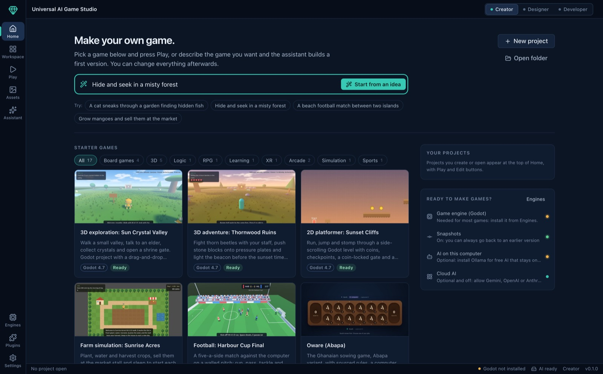
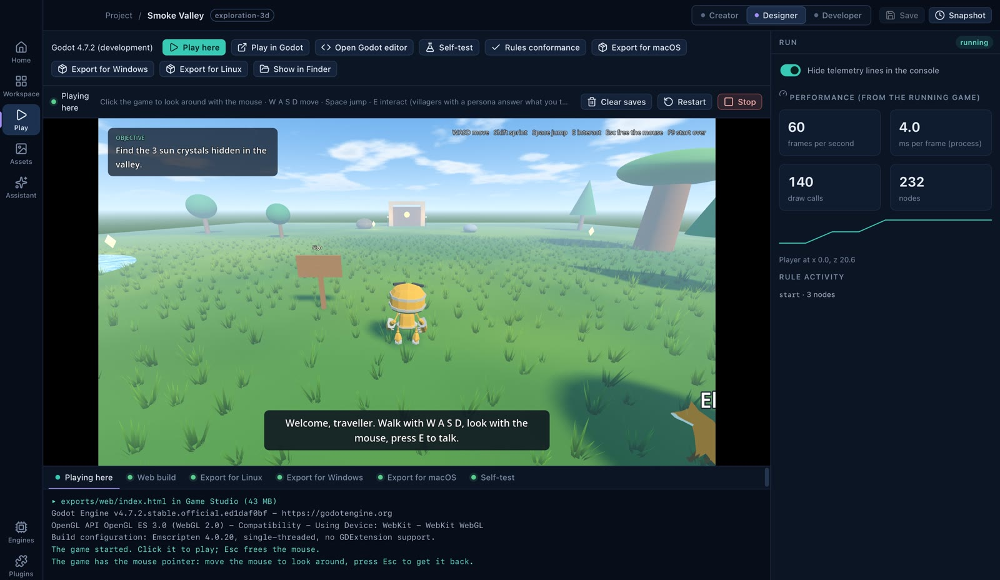
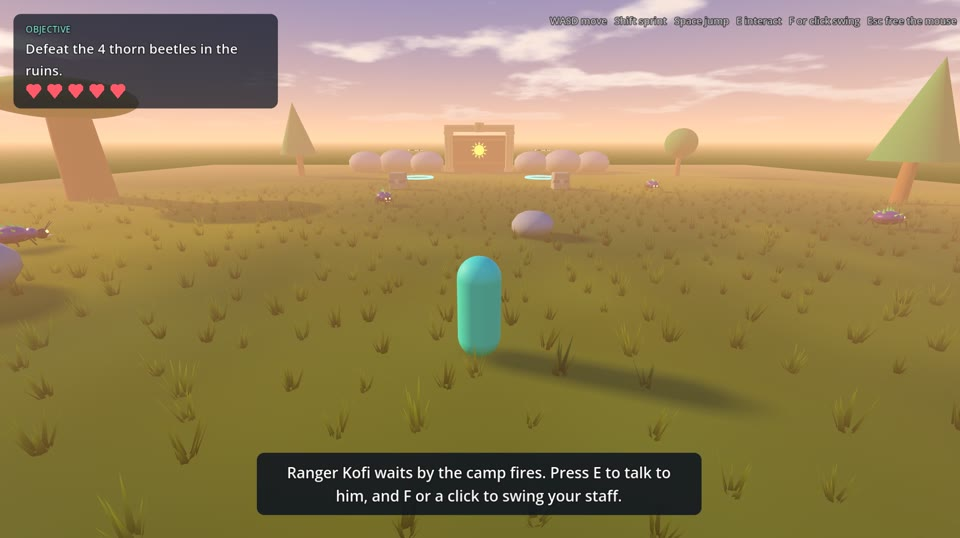
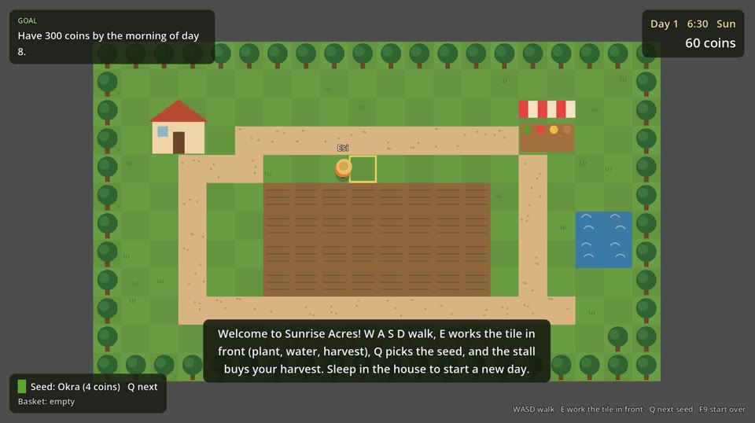
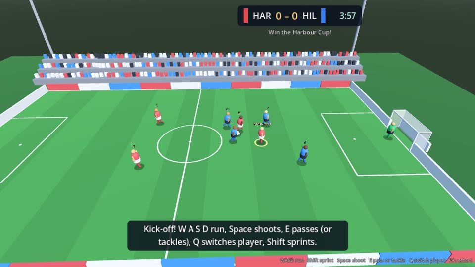
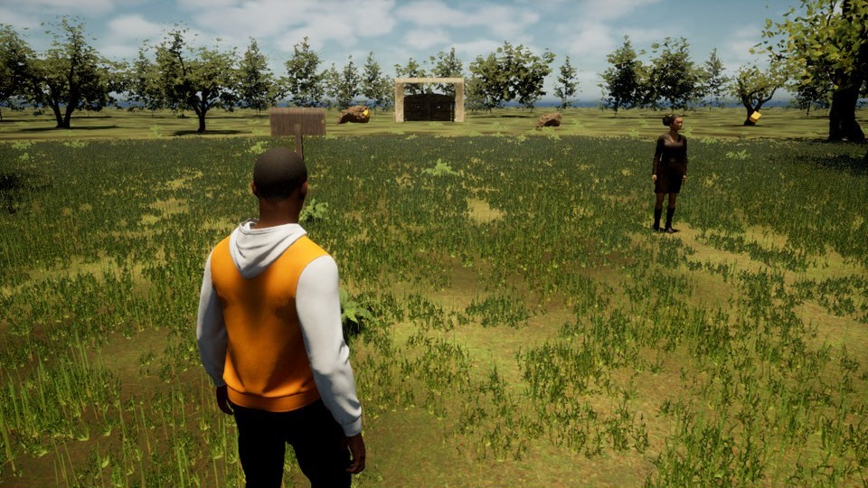

# Universal AI Game Studio (Project 4)

A modular desktop studio for building playable, editable games: Tauri 2 + React + TypeScript, with Godot 4.7.2 as the primary engine, visual rule graphs that compile to an engine-neutral IR, and an optional, permission-scoped AI assistant.





| | |
|---|---|
|  **3D adventure:** Thornwood Ruins (Godot) |  **Farm simulation:** Sunrise Acres (Godot) |
|  **Football:** Harbour Cup Final (Godot) |  **Unreal Engine 5:** Kellan, Elder Ama, scanned trees, rocks and grass |

**New here?** Read the [user guide](docs/user-guide/README.md) (draft).

## Status

Built and verified on macOS, including Godot exports for macOS, Windows and Linux, and first adapters for Unity 6 and Unreal Engine 5. XR has not been tried on a headset; the limits of each template are listed below.

## Requirements

- macOS (Apple Silicon tested), Node 22.18+, Rust 1.85+, Git
- Godot 4.7.2 for 3D projects (install from the app's Engines view, or use `.engines/` in development)
- Optional: Godot 4.7.2 export templates for the Export buttons (macOS, Windows, Linux) and Play here (Engines view, about 1.3 GB, SHA-512 checked)
- Optional: Podman or Docker, for the engine tests to run the exported Windows and Linux games (`CONTAINER_BIN`)
- Optional: Unity 6 through Unity Hub, with Mac Build Support and an activated licence (Personal is free), for the Unity template
- Optional: Unreal Engine 5.8 from the Epic Games Launcher for the Unreal template, plus Xcode selected with `sudo xcode-select -s /Applications/Xcode.app/Contents/Developer` and its Metal toolchain (`xcodebuild -downloadComponent MetalToolchain`); the Engines view checks both
- Optional, for the realistic Unreal template: Epic's free [Game Animation Sample](https://www.fab.com/listings/880e319a-a59e-4ed2-b268-b32dac7fa016) (Fab, Add to My Library; then in the Epic Games Launcher, Unreal Engine › Library › Fab Library › Create Project with 5.8 and the suggested Documents/Unreal Projects folder). About 7 GB
- Optional: CMake + SFML 3 (`brew install cmake sfml`) for the C++ template; Ollama for local AI

## Commands

```sh
npm install
npm run dev          # desktop app (Tauri dev window)
npm run dev:web      # browser preview with in-memory projects (no engines, no file access)
npm test             # TypeScript unit and integration tests
npm run test:rust    # Rust backend tests
npm run test:e2e     # Playwright UI tests against the browser preview (Chromium)
npm run typecheck
GODOT_BIN=.engines/godot/4.7.2-stable/Godot.app/Contents/MacOS/Godot npx vitest run packages/project/src/godot.integration.test.ts
CONTAINER_BIN=/opt/podman/bin/podman GODOT_BIN=.engines/godot/4.7.2-stable/Godot.app/Contents/MacOS/Godot npx vitest run packages/project/src/godot.integration.test.ts   # also runs the Windows and Linux exports in containers
CMAKE_BIN=/opt/homebrew/bin/cmake npx vitest run packages/project/src/godot.integration.test.ts -t "C\+\+"
UNITY_BIN=/Applications/Unity/Hub/Editor/6000.6.9f1/Unity.app/Contents/MacOS/Unity npx vitest run packages/project/src/unity.integration.test.ts
UNREAL_ROOT="/Users/Shared/Epic Games/UE_5.8" npx vitest run packages/project/src/unreal.integration.test.ts
UNREAL_ROOT="/Users/Shared/Epic Games/UE_5.8" UNREAL_SAMPLE="$HOME/Documents/Unreal Projects/GameAnimationSample" npx vitest run packages/project/src/unreal.integration.test.ts -t realistic   # first package cooks the sample: long
OLLAMA_LIVE=1 npx vitest run packages/agents -t "live local model"
GEMINI_API_KEY=... cargo test --manifest-path apps/desktop/src-tauri/Cargo.toml live_gemini -- --ignored   # one short billed call
```

End-to-end check of the real desktop app: build it with `npx tauri build --debug --no-bundle` (in `apps/desktop`), then run
`apps/desktop/src-tauri/target/debug/game-studio --smoke-test <empty folder>`. The app drives its own webview, Rust commands,
Godot, Unity, Unreal and (if running) Ollama, clicks the Play view and navigation buttons in its own window, drives the
3D view and a game playing here with native mouse, trackpad and keyboard events, saves two pictures of the window, writes
`<folder>/smoke-report.json` and exits with code 0 only when every check passed. Checks for tools that are not installed
are reported as skipped. Two opt-in extras: `--smoke-extras editors,templates` also clicks Open in Unity and Open in Unreal
(each opens the editor's window; the first Unreal editor start compiles shaders for many minutes) and, when the Godot
export templates are missing, installs them from the Engines view's button (a 1.3 GB download).

## Templates

| Template | Status |
|---|---|
| Oware (Abapa), sourced rules, editable graph, computer opponent | Ready |
| 3D adventure models made with Kiln: the thorn beetle, stone block, wooden crate and shrine gate are editable Kiln sources (`templates/exploration-3d/kiln/`), shipped with Thornwood Ruins; blocks and gates can use any imported model | Ready |
| Oware (Nam-nam): relay sowing, fours captured as they form, the last eight seeds and rounds in which houses change hands, from oware.org's Nam-Nam rules and First Step Tours' beginner video; sources and choices in `docs/rulesets/oware-namnam.md` | Ready |
| 3D exploration (Godot): world editor with a top-down map and a 3D view (drag, turn and drop objects in either), rule-driven objectives, progress saved as you play, Play here (the game runs inside Game Studio, with mouse look and its saves kept), Export for macOS, Windows and Linux | Ready |
| 3D adventure (Godot): Thornwood Ruins, the same template with enemies that chase you and a staff to fight them (F or a click), hearts and a healing spring, stone blocks pushed onto pressure plates, and a sunset countdown. Any Godot 3D project can use these pieces (world editor: **Enemy**, **Pushable block**; rules: enemies, health, blocks, timers) | Ready |
| 3D exploration in Unity: the same level and rules (objectives, Elder Ama, the shrine gate, sounds) run by a C# rule runtime, macOS build and self-test | Ready (no saved progress or Play here; those are Godot's) |
| 3D exploration in Unreal: the same level and rules run by a C++ rule runtime in a small C++ module, packaged macOS app and self-test | Ready (no saved progress or Play here; those are Godot's) |
| 3D exploration in Unreal, realistic people: the player is the motion-matching character from Epic's free Game Animation Sample (500+ motion-captured moves: walk, run, sprint, crouch, jump, vault) wearing its MetaHuman, Kellan, under Lumen light, volumetric clouds and height fog. The sample's content is copied (cloned, no extra space on APFS) from your copy in Documents/Unreal Projects when the project is made, and kept out of the project's snapshots | Ready. On the first build Game Studio downloads and prepares photographed trees, rocks, ferns, grass, a wooden gate and brass lanterns (Poly Haven, CC0) and Elder Ama (a Microsoft Rocketbox woman, MIT), about 390 MB once, each file checked; anything that fails falls back to simple shapes. Elder Ama is not a MetaHuman. Esc frees the mouse, a click takes it back |
| Visual logic sandbox | Ready |
| Creature collection, science lesson, XR valley, C++/SFML arcade | Foundations (limits listed in the app) |
| Ayò (Yoruba mancala): two-or-three captures on the Oware engine, sources and the accounts it does not follow in `docs/rulesets/ayo.md` | Ready |
| Ludo (Classic): 2 to 4 players, people or computer, seeded dice that replay exactly, every house rule a setting | Ready |
| 2D platformer (Godot): Sunset Cliffs, with coins, spikes, beetles, a checkpoint, a coin-locked gate and a goal flag; side-view level editor; Play here; Export for macOS, Windows and Linux | Ready |
| Farm simulation (Godot): Sunrise Acres, a top-down farm where you plant, water and harvest crops, sell at the market stall and sleep to start each day, with rain, a market day and a money goal for the season; saved as you play. Farm editor: paint the map from tiles (soil, paths, water, trees, fences, the house, the stall), define up to 8 crops (name, seed cost, growing days, yield, price, colour, watering, regrowth), and set the farmer, the money, the day length and the rain; rules for days, planting, harvests, sales, prices and the season; the Farm Designer assistant | Ready |
| Football (Godot): Harbour Cup Final, 2- to 5-a-side on a walled pitch against the computer (running, passing, shooting, tackling, keepers, a match clock, a golden goal when level). Match editor: team names, short names and colours, squads (each player's name, shirt number, pace, shooting and tackling), players a side, minutes, the computer's skill, the pitch, and which side you play (or watch the computer play both); rules for goals, minutes and full time; the Match Designer assistant | Ready |

## Exporting games

Godot projects export from the Play view, into the project's `exports/` folder (kept out of snapshots):

- **Export for macOS**: a universal app, ad-hoc signed and not notarized. The exported app runs its own self-test.
- **Export for Windows** and **Export for Linux**: 64-bit x86 programs (`.exe`, `.x86_64`), each with its game data in a
  `.pck` beside it. They cannot run on a Mac, so Game Studio runs the exported game data's self-test with Godot here.
  The engine tests also run the programs themselves when `CONTAINER_BIN` is set: the Linux one in an x86-64 Debian
  container, the Windows one under Wine in the same kind of container. The `.exe` is not code-signed, so Windows
  SmartScreen may warn the first time someone runs it.
- An older project gets the presets it needs only after you agree to the listed changes.
- Unity and Unreal projects build for macOS only here: Unity needs its Windows and Linux Build Support modules (added in
  Unity Hub), and Unreal cannot build Windows or Linux games on a Mac.

## Start from an idea

Home, **Start from an idea**: describe a game, paste a link to a page about one, or both. The assistant (Gemini, OpenAI or a
local Ollama model) picks the closest ready template (2D platformer, 3D exploration, 3D adventure, football, farm simulation, Ludo, Oware Abapa, Oware Nam-nam or Ayò), writes a short
brief and has the template's specialist reshape the starting level or rule settings. You see the plan, what the template
cannot do, and every change before anything is created; the new project keeps a snapshot of the template's starting point.
Linked pages are read as plain text (public addresses only, never this computer or a private network) and given to the
model as information. Ideas based on an existing game keep its genre and mechanics with an original name, layout and look.

## Villagers who answer players

In the 3D templates (Godot), a villager can answer what the player types: in the world editor, select a character and
switch on **Answers players with AI (in Game Studio)**, then write who they are and what they know. When the game plays
inside Game Studio (Play here), pressing E beside them still runs the interact rules, then opens a conversation; each
question goes from the game, through Game Studio, to the AI provider and model chosen in Settings, and the answer comes
back in character. The game never holds a key or sees the prompt: Game Studio takes the persona from the project
itself. Exported games and runs in Godot have no such bridge, so villagers say their written lines there. Elder Ama
(Sun Crystal Valley) and Ranger Kofi (Thornwood Ruins) start with a persona. Questions go to the provider you chose,
which for a cloud provider means its servers.

## Graphics

- **Your own models and textures**: import `.glb`/`.gltf` models and `.png`/`.jpg` textures in Assets, then place models from
  the world editor's **3D model** button. The 3D view draws the real model; in the game it gets a collision box (optional).
- **Free library**: Assets, **Free library** lists Poly Haven's CC0 models and textures (photo-scanned, free for any use).
  Downloads are checked against Poly Haven's MD5 checksums, and the licence, author and source are recorded.
- **Textured ground**: World settings, Ground texture (with the matching normal and roughness maps picked automatically).
- **Sky, sunlight, ground and grass**: World settings sets the sunlight's colour, clouds (0 clear to 1 overcast), patches of
  drier and lusher ground, and grass (tufts that sway in the wind, thicker where the ground is lush, kept out of water and
  zones). Fog covers the sky only as much as it is thick, water ripples and catches the sun, and the 3D view shows all of
  it as the game draws it. Clouds, patches and grass are drawn by the Godot game; the sunlight colour also works in Unity
  and Unreal. Play here (the web build) has real sun shadows on the ground, drawn by the game itself because Godot's web
  renderer cannot (ARCHITECTURE.md, decision 9); football players cast shadows on the pitch too.
- **Realistic style and photographed skies**: Assets, Free library, **Skies** downloads Poly Haven's photographed skies
  (CC0). World settings, **Sky** makes one the level's sky: it lights the level and fills the background, in the game, in
  Play here and in the 3D view. Style **Realistic** draws trees and rocks in detail (branching bark, leaves and pine
  boughs on two-sided cards, rocks with broken faces, crevices and moss, four shapes of each picked by the object's id)
  and gives a filmic colour curve made for photographs; desktop builds add light that bounces, reflections and soft
  shadows. The 3D view builds the same trees and rocks as the game. For people, World settings, **Play as a free
  character** downloads one from the library and plays as it in one step: a realistic woman or man (Microsoft
  Rocketbox, MIT, converted by Godot after downloading) or Godette in the anime style (VRM).
- **Anime style**: World settings, Style, **Anime** draws the level with toon shading (a crisp line between light and
  shade, no gloss, a rim of light), ink outlines round objects, models and characters, and crisp two-tone clouds, in the
  game, in Play here and in the 3D view. Glowing and see-through parts keep their look. Godot projects only.
- **Render quality High**: ambient occlusion, indirect light, glow on bright things, soft four-split sun shadows and 4x
  anti-aliasing in desktop builds (Godot's Forward+ renderer), with the same colours as Standard. The difference is
  modest on the built-in shapes; real models and textures make the bigger change. Play here's web build keeps the standard look.
- **Characters**: in a 3D world, World settings, **Character** plays as an imported, animated character instead of the
  capsule: idle, walk, run (sprint) and jump animations follow the player's movement, picked by name and changeable.
  VRoid Studio characters (`.vrm`) load too (the bundled MIT godot-vrm add-on); characters that come without walking
  animations get Game Studio's own Idle, Walk, Run and Jump, the same in the game and the 3D view.
  Villagers can use a character model and loop an animation, and any placed model can loop one. The studio's 3D view
  plays the same animations (pause them from its toolbar). Free characters: Assets, Free library, **Characters** (a
  robot and Kenney's platformer hero, both CC0, and a fox whose rigging and animation are CC BY 4.0), each a pinned
  file checked against its SHA-256.
- **2D player sprites**: in the platformer, Level settings, **Player sprite** draws the player from a sprite sheet (equal
  frames in a grid) with idle, run and jump frames; it faces the way it runs. The side view shows its standing frame.
- **Textures on objects**: rocks, trees, gates, signs and torches take a texture set (colour, plus matching normal and
  roughness maps), projected in world space so it tiles evenly in metres on any shape; glowing parts keep their colour,
  and "keep the object's colours" tints it. Platforms in the 2D platformer can be tiled with a picture.
- **Sounds and music**: each level's Sound settings choose looping background music and replace any of the template's
  built-in sounds (chime, gate, coin, jump and so on) with an imported `.ogg`, `.wav` or `.mp3`; rules keep naming the
  built-in sounds, so they still work everywhere. Free CC0 sound effects: Assets, Free library, **Sounds** (Kenney).
- Imported models and characters are placed in Godot projects; Unity and Unreal projects import them in their own editors.
- Realistic people in Unreal come from Epic's Game Animation Sample, which you add from Fab yourself (its licence is
  Epic's, for Unreal projects). Its content is copied into each realistic project and never into Game Studio's files.
  Kellan's groom hair cannot be drawn by Unreal on Macs (Metal SM5), so Game Studio gives him a short hair cap made from his
  own head. The valley's trees, rocks, grass, gate, lanterns and Elder Ama are free models Game Studio downloads itself
  (Poly Haven, CC0; Microsoft Rocketbox, MIT), credited in the project's `Content/GameStudioNature/CREDITS.txt`.
- AI-made pictures (sprites, textures): Gemini's image models need billing enabled on the key's Google Cloud project (its
  free tier allows no image requests), and Ollama's experimental local image models are a multi-gigabyte download not
  made yet. Until one of those is set up, art comes from imports and the free library.
