# Game Studio user guide

> **Draft, 26 November 2026.** This guide covers what Game Studio does today on macOS. The screenshots of editors come from the app's browser preview, which shows the same screens as the
> desktop app but has no engines, so its status bar says "Godot not installed".

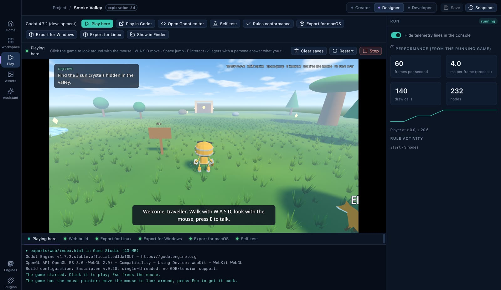

Game Studio makes games you can play straight away and then change. Every project starts from a template that already
plays: a 3D valley, a 2D platformer, a farm, a football match or a board game. You change it by moving things on a map,
editing settings in forms, wiring visual rules, or asking the AI assistant. The game runs in Godot (or Unity or Unreal for
those templates), and every change stays editable.

## Contents

1. [Before you start](#1-before-you-start)
2. [The window](#2-the-window)
3. [Making a project](#3-making-a-project)
4. [Editing a 3D world](#4-editing-a-3d-world)
5. [Rules](#5-rules)
6. [Playing and testing](#6-playing-and-testing)
7. [The other templates](#7-the-other-templates)
8. [Art, models, characters and sounds](#8-art-models-characters-and-sounds)
9. [The AI assistant](#9-the-ai-assistant)
10. [Snapshots and undo](#10-snapshots-and-undo)
11. [Exporting your game](#11-exporting-your-game)
12. [Unity and Unreal projects](#12-unity-and-unreal-projects)
13. [Troubleshooting](#13-troubleshooting)

## 1. Before you start

Game Studio runs on macOS (tested on Apple Silicon). Board games play inside the app with nothing else installed. For
everything else you need an engine:

| You want to | You need | How |
|---|---|---|
| Play and edit the 3D, platformer, farm and football games | Godot 4.7.2 | **Engines** view, Install |
| Play those games inside Game Studio, or export them | Godot's export templates (about 1.3 GB) | **Engines** view |
| Make Unity games | Unity 6 with Mac Build Support | Unity Hub (free Personal licence) |
| Make Unreal games | Unreal Engine 5.8 and Xcode | Epic Games Launcher, App Store |
| Make the realistic Unreal game | Epic's free Game Animation Sample (about 7 GB) | Fab, then the Epic Games Launcher |
| Use the AI assistant | A local model (Ollama) or a cloud key | **Settings** |

The **Engines** view checks what is installed and says what is missing. Game Studio never downloads an engine without
you clicking to do it.

## 2. The window

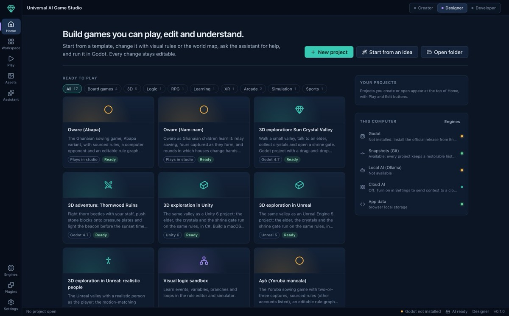

The bar on the left switches between the main views:

- **Home**: your projects, the templates, and what is installed on this computer.
- **Workspace**: the project's files, rules, world map and editors.
- **Play**: runs the game, exports it and shows its output.
- **Assets**: your imported files and the free library.
- **Assistant**: chat with the AI about your project.
- **Engines**, **Plugins** and **Settings** sit at the bottom.

At the top right, **Creator**, **Designer** and **Developer** change how much the **Workspace** shows; the other views
look the same in every mode. A note says what changed each time you switch.

| | Creator | Designer | Developer |
|---|---|---|---|
| Rules | Plain sentences and settings | The node graph, with the Simulate tab | The graph plus a **Compiled** tab |
| Left panel | Outline only | Adds Godot scenes and a **Files** tab | Opens on Files and adds scripts |
| Levels, farm, match, project settings | Visual editors | Visual editors | An **Editor / JSON** switch above each, and **Edit gamestudio.json** |
| Assistant | | | Shows each applied change's before and after |

In the JSON view, an edit applies as soon as the text is valid JSON; until then a note says what is wrong and the last
valid version is kept. All three modes edit the same project, so you can switch at any time.

**Save** (⌘S) writes your changes. **Snapshot** keeps a restorable copy (see [section 10](#10-snapshots-and-undo)).

## 3. Making a project

### From a template

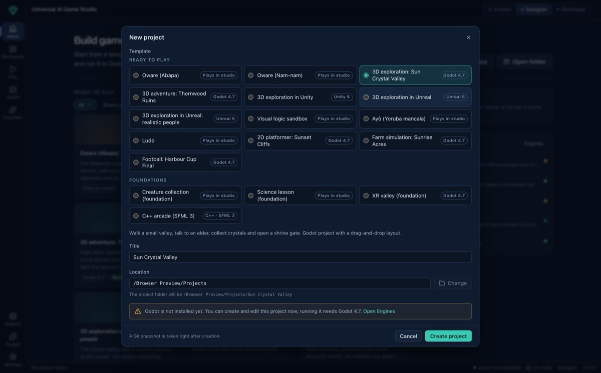

On Home, click **New project**, pick a template, give it a title and a folder, then **Create project**. Templates marked
*Plays in studio* run inside Game Studio. The others show the engine they need. If that engine is missing you can still
create and edit the project, and the dialog links to the Engines view.

*Foundations* (creature collection, science lesson, XR valley, C++ arcade) are smaller starting points. Their limits are
listed in the app.

### From an idea

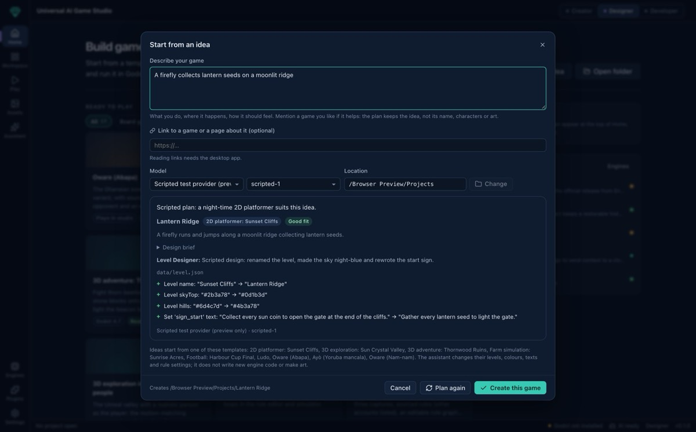

**Start from an idea** takes a sentence or two about your game, and optionally a link to a page about it. The assistant
picks the closest template, writes a short design brief and lists every change it would make to the starting level.
Nothing is created until you click **Create this game**. If you name an existing game, the plan keeps its kind of play
but uses an original name, layout and look.

### Opening an existing project

**Open folder** opens a project folder from anywhere on your Mac. Projects you have opened appear at the top of Home with
**Play** and **Edit** buttons.

## 4. Editing a 3D world

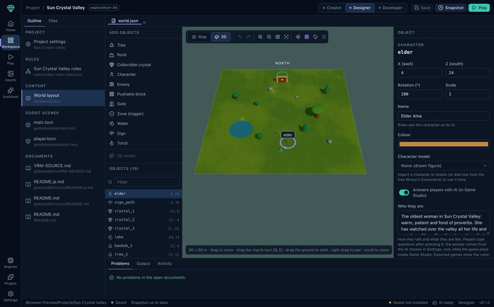

Open **World layout** in the Workspace. The middle switches between **Map** (top-down) and **3D**.

- **Add objects** on the left: drag a tree, rock, crystal, character, enemy, block, gate, zone, water, sign or torch onto
  the map or the 3D view.
- **Move** an object by dragging it. **Turn** it by dragging its ring, or press Q and E.
- **Camera** in 3D: drag the ground to orbit, right-drag to pan, scroll or pinch to zoom.
- **Objects** lists everything in the level. Click one to select it and fly the camera to it.
- The **Object** panel on the right edits the selection: position, rotation, scale, name, colour and model. Rules refer
  to objects by their id (for example `elder` or `crystal_1`).

### Villagers who answer players

Select a character and switch on **Answers players with AI (in Game Studio)**, then write who they are and what they
know. When the game runs with **Play here**, pressing E beside them opens a conversation answered by the AI chosen in
Settings. Exported games have no AI, so villagers say their written lines.

### World settings

Click an empty spot on the map, or press Esc, and the right-hand panel shows **Level settings** for the whole level.
Changes show in the 3D view straight away, drawn the way the game draws them.

**Level and player**

| Setting | What it does |
|---|---|
| Level name, Width, Depth | The level's title and size in metres (20 to 400 each way). |
| Walk speed, Sprint ×, Jump | How fast the player walks, how much faster Shift makes them, and how high they jump. |
| Camera distance | How far behind the player the camera follows. |
| Hearts | How many hit points the player starts with (Godot only). Enemies and the Hurt Player rule take them. |
| Character | Plays as an imported, animated model instead of the capsule (Godot only). Set its height and turn, and pick which of its animations to use for idle, walk, run and jump. Characters without walking animations get Game Studio's own. |
| Play as a free character | Shown when no character is chosen: pick one from the free library and click **Play as it** to download it, add it to Assets and make it the player in one step. |

**Environment**

| Setting | What it does |
|---|---|
| Sky (top), Sky (horizon), Ground | The sky's two colours and the ground colour. |
| Fog density | 0 is clear. Fog fades distant things into the sky's colour. |
| Sun height, Sun heading | Where the sun sits, which also sets the length and direction of shadows. |
| Sunlight | The sun's colour: warm for an evening, white at midday. Works in all three engines. |

**Graphics** (Godot projects; the Unity and Unreal templates set their look in their own editors)

| Setting | What it does |
|---|---|
| Style | **Standard** is clean and bright. **Anime** gives toon shading, ink outlines and crisp two-tone clouds. **Realistic** draws trees and rocks in detail (bark, leaves, broken stone, moss), uses a filmic colour curve made for photographs and, in desktop builds, adds bounced light, reflections and soft shadows. |
| Sky | **Colours and clouds**, or a photographed sky you downloaded from the free library's Skies. A photographed sky lights the whole level. **Sky brightness** adjusts it (1 is as photographed). |
| Clouds | 0 is a clear sky, 1 overcast. Not used with a photographed sky. |
| Ground patches | Patches of drier and lusher ground. 0 is one even colour. |
| Grass | Tufts that sway in the wind, thicker where the ground is lush. 0 is none, 1 thick. Water and zones stay clear. |
| Render quality | **High** adds ambient occlusion, glow, soft shadows and anti-aliasing to desktop builds. Play here always uses the standard look. |
| Ground texture | A colour image repeated over the ground, with its **Normal map** and **Roughness map** picked for you when they come as a set. **Repeat every (m)** sets how large it is. |

**Sound** is at the bottom of Level settings: see [section 8](#sounds-and-music).

## 5. Rules

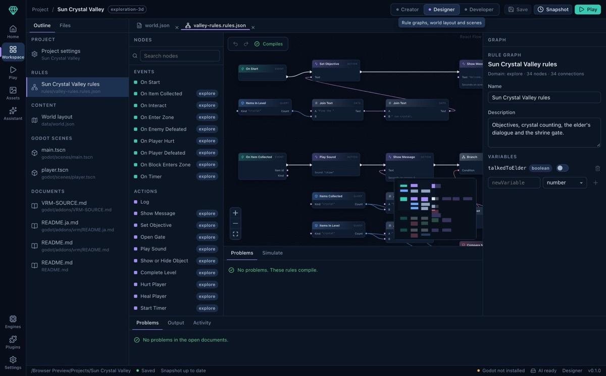

Rules decide what happens in a game: what a crystal does when you pick it up, what the elder says, when the gate opens.
Open a rules file in the Workspace.

In **Designer** mode a rule is a graph. **Events** (green) start a chain: On Start, On Item Collected, On Interact, On
Enter Zone and so on. **Actions** (purple) do something: show a message, set the objective, play a sound, open a gate.
**Data** and **queries** count things, join text and compare values. Drag a node from the left onto the canvas, then
connect its outputs to the next node's inputs. The panel on the right holds the graph's name, description and
**variables** (for example `talkedToElder`).

The badge at the top says whether the rules **Compile**. Problems are listed underneath with the node at fault.

In **Creator** mode the same rules read as sentences and settings, which is easier for small changes.

### Trying rules without running the game

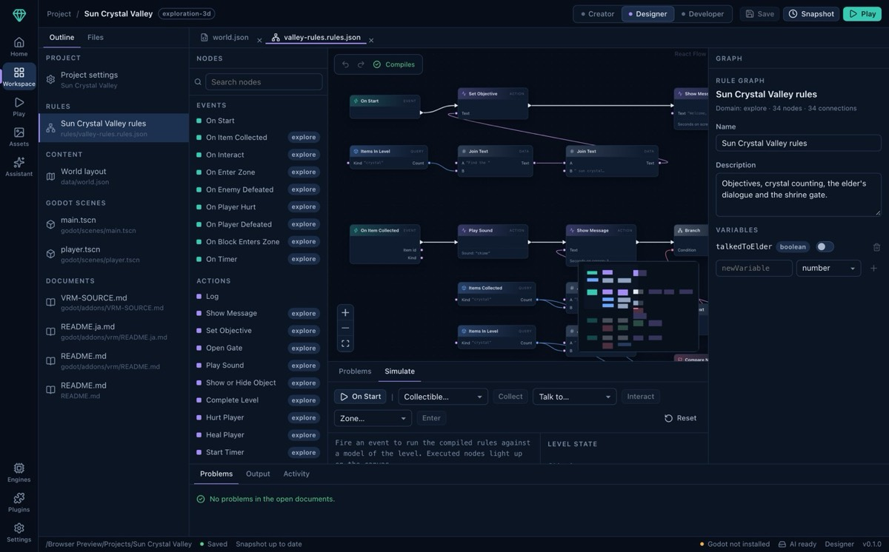

The **Simulate** tab runs the rules against a model of the level. Fire **On Start**, collect a crystal, talk to a
character or enter a zone, and the nodes that ran light up on the canvas. The level state shows what changed.

Some nodes only work in Godot games (enemies, health, blocks, timers). In Unity and Unreal projects they are greyed out
with the reason.

## 6. Playing and testing

The **Play** view runs the game. For Godot projects:

- **Play here** builds a web version and plays it inside Game Studio, beside a panel showing frame rate, the player's
  position and which rules ran. Saves made in the game are kept per project; **Clear saves** removes them.
- **Play in Godot** opens the game in its own window.
- **Open Godot editor** opens the project in Godot.
- **Self-test** plays the game automatically and reports what passed.
- **Rules conformance** checks that the engine runs your rules the same way Game Studio does.

### In-game controls

| Game | Controls |
|---|---|
| 3D valley and adventure | Click to look around with the mouse, W A S D move, Shift sprint, Space jump, E interact, F or click swing the staff (adventure), Esc frees the mouse, F9 start over |
| 2D platformer | A D or arrows run, Space jump (hold for higher), F9 start over |
| Farm | W A S D walk, E work the tile in front, Q next seed, F9 start over |
| Football | W A S D run, Shift sprint, Space shoot, E pass or tackle, Q switch player, F9 restart |
| Unity and Unreal valley | W A S D move, hold the right mouse button to look (realistic Unreal: the mouse looks; Esc frees the mouse and a click takes it back) |

## 7. The other templates

### 2D platformer

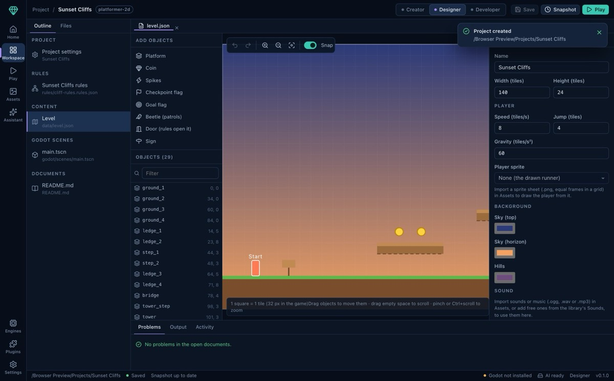

A side-view editor. Drag coins, spikes, beetles, platforms, a checkpoint and the goal flag into the level, and edit each
one in the inspector. Level settings hold the sky colours, jump height and the player's sprite sheet.

### Farm simulation

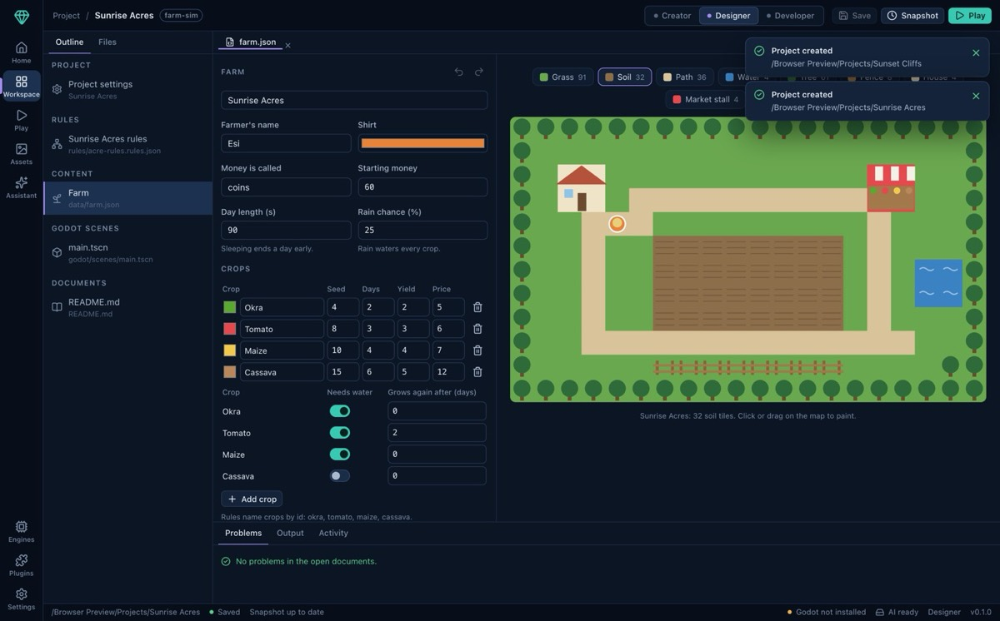

Paint the map from tiles (soil, paths, water, trees, fences, the house and the market stall). Set the farmer's name, the
money, how long a day lasts and the chance of rain. Up to eight crops, each with a seed cost, growing days, yield, price,
colour, whether it needs water and when it grows again. Crops grow overnight when watered or rained on.

### Football

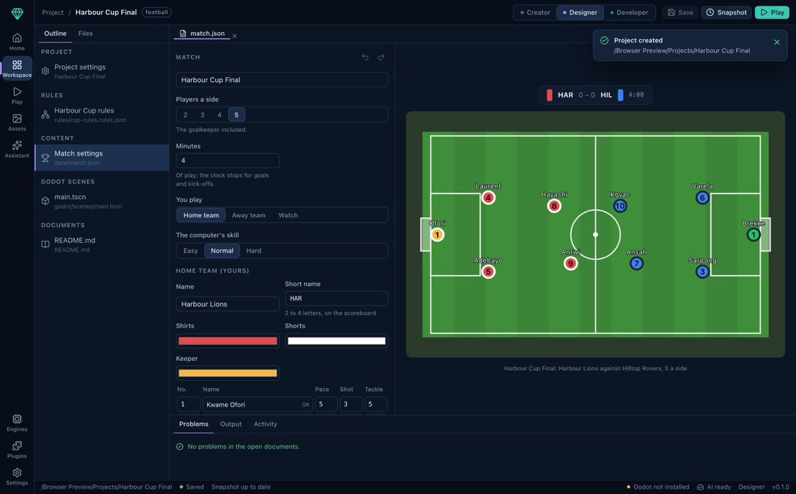

Name the two teams and their colours, edit each squad (name, shirt number, pace, shooting, tackling), and set the
players a side (2 to 5), the minutes, the computer's skill and which side you play. You can also watch the computer play
both sides.

### Board games

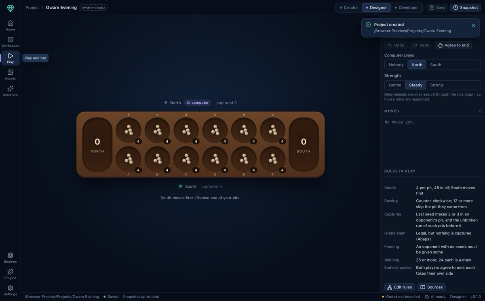

Oware (Abapa and Nam-nam), Ayò and Ludo play inside Game Studio. Choose who the computer plays and how strong it is.
**Rules in play** lists the rules in words, **Sources** shows where each rule comes from, and **Edit rules** opens the
rule graph, so you can make your own house rules.

## 8. Art, models, characters and sounds

Open **Assets** in the left bar. It lists the files in the project's `godot/assets/` folder with each one's source and
licence, which you can fill in when you select a file.

### Importing your own files

Drop files on the window or click **Import files**. Game Studio takes:

- models: `.glb` and `.gltf` (with their textures), and `.vrm` characters from VRoid Studio;
- pictures: `.png` and `.jpg`, used as textures or sprite sheets;
- sounds and music: `.ogg`, `.wav` and `.mp3`;
- fonts.

### The free library

**Free library** downloads free, ready-made assets into the project. Every file is checked against a published checksum
before it is saved, and its author, licence and source are recorded.

| Tab | What is there | Licence |
|---|---|---|
| Models | Photo-scanned rocks, plants, furniture and props from Poly Haven | CC0 (free for any use) |
| Textures | Ground, stone, wood and other surfaces, each with matching normal and roughness maps, at 1k, 2k or 4k | CC0 |
| Skies | Photographed skies (`.hdr`) that light a level | CC0 |
| Characters | Robot (expressive), Kenney platformer character, Fox, Godette (anime, VRM), and a realistic woman and man (Microsoft Rocketbox) | CC0, CC BY 4.0 (Fox) or MIT |
| Sounds | Sound effects from Kenney | CC0 |

The realistic woman and man are converted by Godot after downloading, so they need Godot installed.

### Using models in a level

In the world editor, the **3D model** button places an imported model. The 3D view draws the real model, and in the game
it gets a collision box (switch off **The player bumps into it** for decoration). A model with animations can loop one.

Villagers, enemies, pushable blocks and gates have a **Character model** or **Model** setting, so a beetle or gate can be
drawn with your own model while it keeps behaving the same way.

### Textures on objects

Rocks, trees, gates, signs and torches have a **Texture** setting. The texture is laid across the object in world space,
so it tiles evenly whatever the object's shape. **Repeat every (m)** sets its size, and **Keep the object's colours over
the texture** tints it with the object's colour. Glowing and see-through parts keep their colour.

### Characters

There are two ways to change who the player is, both in Level settings:

- **Play as a free character** downloads one from the library and uses it at once.
- **Character** picks a model already in Assets.

Villagers take a **Character model** in the Object panel, with an **Animation** to loop. In the 2D platformer, Level
settings, **Player sprite** draws the player from a sprite sheet (equal frames in a grid) with idle, run and jump frames.

### Sounds and music

Each template has built-in sounds (a chime, the gate, coins, jumps and so on) that the rules play by name. At the bottom
of Level settings:

- **Music** loops a file while the level plays, at the **Music volume** you set.
- Each built-in sound can be replaced with your own file. Rules keep naming the built-in sound, so they still work.

The play button beside each choice previews it. Imported sounds play in Godot projects; Unity and Unreal keep their
generated sounds.

### What works where

Only Godot projects place imported models, characters, textures and sounds. Unity and Unreal projects import assets in
their own editors. AI-made pictures need an image model: Gemini's need billing on the key's Google Cloud project, and none
is set up yet, so art comes from imports and the free library.

## 9. The AI assistant

The assistant is optional: every project plays, saves and runs without it.

In **Settings**, choose a provider: a local Ollama model, or Gemini, OpenAI or Anthropic with a key read from your
environment. Export the key in your shell profile (for example `export GEMINI_API_KEY=...` in `~/.zshrc` or
`~/.bash_profile`); Game Studio reads it from there even when you open it from the Dock or Finder. Keys are never stored
in projects or passed to games. Cloud providers stay off until you tick the box agreeing that
they receive the project context you send and bill your account.

In the **Assistant** view, pick a specialist (World Builder, Rules Engineer, Rule & Cultural Reviewer) or leave it on
**Automatic**. Ask questions or describe a change. A proposed change is shown as a list before anything is written; click
**Apply changes** to accept it. Each applied change takes a snapshot, so you can roll it back.

## 10. Snapshots and undo

Every project is a Git repository. A snapshot is taken when a project is created and each time the assistant applies a
change, and you can take one yourself with **Snapshot**. The Snapshot dialog lists them and restores any of them.

Editors have their own **Undo** and **Redo** (⌘Z, ⇧⌘Z) for recent edits.

## 11. Exporting your game

From the **Play** view of a Godot project:

- **Export for macOS** makes an app you can share. It is not notarized, so on other Macs it has to be allowed once in
  System Settings, Privacy & Security, before it opens.
- **Export for Windows** and **Export for Linux** make a program with its game data beside it. Windows may warn the first
  time, because the program is not code-signed.

Exports go into the project's `exports/` folder. Unity and Unreal projects build for macOS only.

## 12. Unity and Unreal projects

The Unity and Unreal templates run the same valley and rules as the Godot one, using their own rule runtimes. They have
no Play here and no saved progress. **Open in Unity** and **Open in Unreal** open the project in the engine's editor.

The **realistic Unreal** template plays as Kellan, the motion-captured MetaHuman from Epic's Game Animation Sample,
under Lumen light. On its first build Game Studio downloads and prepares photographed trees, rocks, grass, a gate and
lanterns (Poly Haven) and Elder Ama (Microsoft Rocketbox), about 390 MB once. The first build of a realistic project
takes a long time because Unreal compiles shaders.

## 13. Troubleshooting

| Problem | What to do |
|---|---|
| A button is greyed out | Hover over it: the tooltip says why (usually a missing engine or an unsaved change). |
| Play here shows a notice and no picture | The Mac was busy when the game's shaders compiled. Click **Restart**. |
| The game has your mouse | Press **Esc**. Click in the game to take it back. |
| "Godot not installed" | Open **Engines** and install Godot 4.7.2. |
| The assistant does nothing | Check **Settings**: a provider must be available, and cloud providers must be allowed. |

### Where things are kept

| What | Where |
|---|---|
| New projects | `~/Documents/Game Studio Projects/<project name>/` (you can pick another folder when creating one) |
| Inside a project | `gamestudio.json` (the project), `data/` (levels and settings), `rules/` (rule graphs), `godot/` (the engine project; imported files go in `godot/assets/`), `exports/` (builds, kept out of snapshots) and a `.git` folder holding the snapshots |
| App settings, recent projects and the activity log | `~/Library/Application Support/org.project4.gamestudio/studio.db` |
| Saves from games played with Play here | `~/Library/Application Support/org.project4.gamestudio/play-saves/` |
| Godot installed from the Engines view | `~/Library/Application Support/org.project4.gamestudio/engines/` |
| Godot's export templates | `~/Library/Application Support/Godot/export_templates/` |
| Trees and people downloaded for realistic Unreal projects | `~/Library/Application Support/org.project4.gamestudio/unreal-nature/` |

Deleting a project folder deletes the project and its snapshots. Game Studio never deletes it for you.

### Reporting a problem

1. Open the **Activity** tab at the bottom of the Workspace. It lists what you and the assistant changed, and when.
2. Open the **Output** tab, or the console in the Play view, and copy the lines around the error.
3. If a game misbehaves, run **Self-test** in the Play view and note which checks failed.
4. Open an issue at https://github.com/reubebe/ai-game-studio/issues with what you did, what you expected, what happened
   and the lines you copied. Leave out API keys and personal details.

## Glossary

| Word | Meaning |
|---|---|
| Template | A complete, playable game that a new project starts from. |
| Foundation | A smaller starting point with listed limits, not yet a full game. |
| Level, world layout | The objects in a game and where they are, kept in `data/`. |
| Object id | The short name rules use for an object, such as `elder` or `crystal_1`. |
| Rule graph | A game's rules drawn as connected nodes. |
| Event, action, query | Node kinds: an event starts a rule, an action does something, a query reads the game's state. |
| Compile | Checking a rule graph and turning it into the form every engine runs. |
| Simulate | Running the rules against a model of the level, without an engine. |
| Rules conformance | A check that the engine runs your rules exactly as Game Studio's simulator does. |
| Self-test | A run where the game plays itself and reports what passed. |
| Play here | Playing a Godot game's web build inside Game Studio. |
| Snapshot | A saved copy of the whole project you can go back to. |
| Specialist | One of the assistant's roles, each allowed to change only certain things. |
| Export | Building a game that runs without Game Studio. |
| Engine | The program that runs the game: Godot, Unity or Unreal. |
| Export templates | Godot's files for building web, macOS, Windows and Linux versions. |
| CC0, CC BY, MIT | Licences: CC0 has no conditions, CC BY needs the author credited, MIT needs its notice kept. |
